# SQL 실행 결과

## 준비

### 준비: 외래 키·영화 전체·찜 전체 조회

성공

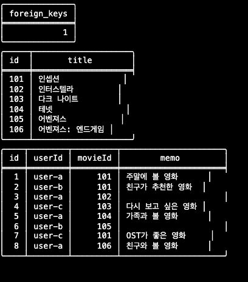

## 조건 조회 05·06·07·08

### TODO 05 — 영화 101의 userId, memo 조회

성공

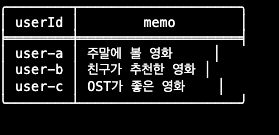

### TODO 06 — user-a의 영화 104 메모 조회

성공

### TODO 07 — user-c의 영화 ID 내림차순 1건 조회

성공

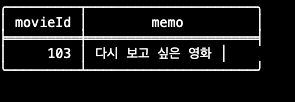

### TODO 08 — user-c의 영화 ID 내림차순 전체 조회

성공

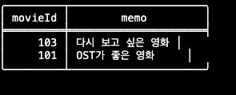

## 빈 메모 JOIN·전체 집계·사용자별 집계 14·15·16

### TODO 14 — JOIN으로 빈 메모 목록 조회

성공

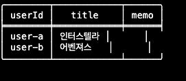

### TODO 15 — 전체 빈 메모 건수

성공

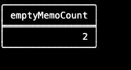

### TODO 16 — 사용자별 빈 메모 건수

성공

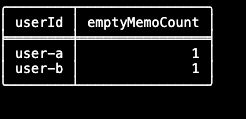

## CRUD 09·10·11

### TODO 09 — 새 찜 추가

성공

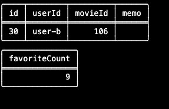

### TODO 10 — 메모 수정

성공

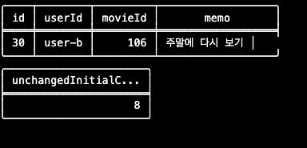

### TODO 11 — 찜 삭제

성공

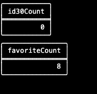

### 삭제 후 초기 찜과 메모 확인

성공

## 제약조건 A·B·C·D

### A — 중복 사용자·영화 조합

실패 — user-a와 영화 101 조합이 이미 존재하여 UNIQUE 제약조건을 위반했습니다.

### B — 다른 사용자·영화 조합

성공

### C — 존재하지 않는 영화 참조

실패 — movies에 영화 999가 없어 외래 키 제약조건을 위반했습니다.

### D — 참조 중인 영화 삭제

실패 — 찜 목록에서 영화 106을 참조하고 있어 외래 키 제약조건에 의해 삭제가 차단됐습니다.

### D 직후 찜 9건과 영화 106 유지

성공

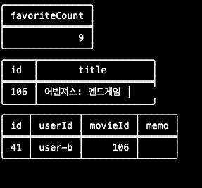

### D 직후 찜 전체 목록

성공

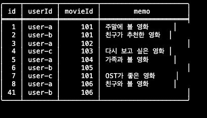

### 정리: 테스트 id 41 삭제

성공

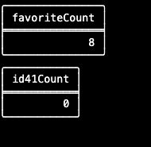

### 정리 후 초기 8건과 메모 확인

성공

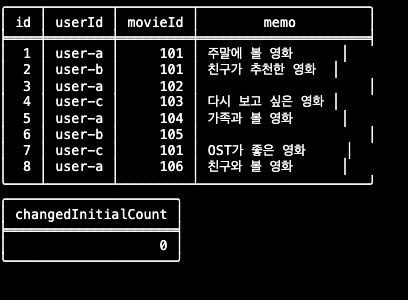
